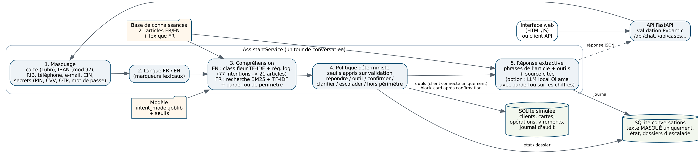

# Assistant de support bancaire — intentions, recherche documentaire, outils et escalade

Projet personnel (Achraf Abderrazik, octobre 2026). **Banque, clients et opérations fictifs** : aucune donnée réelle de
client n'est utilisée. Les requêtes d'entraînement et de test viennent du jeu public **Banking77** (PolyAI, CC BY 4.0).
Développé avec l'aide d'un assistant IA de programmation ; tous les chiffres ci-dessous sont reproductibles avec
`python -m assistant build`.

## Problème traité

Un service client bancaire reçoit beaucoup de questions répétitives (carte non reçue, paiement en attente, virement,
code PIN…) et quelques demandes sensibles (carte volée, opération contestée). L'objectif : **répondre automatiquement
uniquement quand c'est fiable**, appeler les bons outils, demander une confirmation avant toute action, et transmettre à
un conseiller le reste — sans jamais stocker de donnée personnelle en clair.

## Ce qui est implémenté (et testé)

| Brique | Réalisation |
|---|---|
| Masquage des données personnelles | carte (contrôle de Luhn, 4 derniers chiffres conservés), IBAN (modulo 97), RIB marocain (24 chiffres), téléphone (+212, 05/06/07, international), e-mail, CIN (après mot-clé), secrets (PIN, CVV, code SMS, mot de passe) avec avertissement |
| Compréhension (anglais) | classifieur TF-IDF mots + caractères et régression logistique, 77 intentions Banking77, probabilités → 21 articles |
| Compréhension (français) | recherche hybride BM25 + TF-IDF mots + TF-IDF caractères sur la base française enrichie d'un lexique ; garde-fou de périmètre |
| Prédiction sélective | seuils appris sur la validation pour viser 95 % d'exactitude sur les réponses automatiques ; sinon clarification puis escalade |
| Outils (base SQLite simulée) | statut des cartes, opérations récentes (détection des débits en double), statut des virements, **blocage de carte après confirmation explicite** (journal d'audit, expiration de la confirmation, isolation par client) |
| Politique | règles déterministes : répondre, appeler un outil, choisir la carte, confirmer, clarifier, escalader, hors périmètre |
| Réponses | extractives (phrases de l'article + résultats d'outils + source citée) ; reformulation par LLM local (Ollama) **optionnelle, non évaluée** |
| API et interface | FastAPI (validation Pydantic, codes 400/403/404/422), interface web, journal SQLite des conversations (texte masqué uniquement), dossiers d'escalade |
| Qualité | 24 tests pytest, 13 scénarios de bout en bout, rapport d'évaluation reproductible |



## Résultats mesurés (exécution du 30/10/2026, `reports/metrics.json`)

Jeu de **test officiel Banking77** (3 080 requêtes réelles, jamais utilisées pour l'entraînement ni pour les seuils) :

| Mesure | Valeur |
|---|---|
| Exactitude intention (77 classes) | **91,0 %** (F1 macro 0,910 ; top-3 97,5 %) |
| Exactitude article (21 articles) | **95,0 %** (classifieur seul 95,1 % ; recherche seule 66,5 %) |
| Requêtes traitées automatiquement (seuil appris sur validation) | **99,2 %**, avec **95,5 %** d'exactitude |
| Prédiction sélective au niveau intention | 92,1 % de couverture, 94,7 % d'exactitude |
| Requêtes anglaises hors périmètre rejetées | 10 / 10 |
| Détection de langue (anglais, Banking77) | 99,5 % |

Requêtes **françaises rédigées par le développeur** (mesure indicative, 63 requêtes de test + 8 hors périmètre) :
top-1 **90,5 %**, top-3 100 %, MRR 0,950 ; hors périmètre rejeté 8 / 8.

Autres : masquage 100 % de précision et de rappel sur un jeu **synthétique** de 168 messages (dont 84 pièges) — test de
non-régression, pas une garantie ; 13 / 13 scénarios de bout en bout ; latence médiane d'un tour complet ≈ 10 ms
(95e centile ≈ 14 ms) sur processeur.

Ce que ces chiffres ne disent pas : le classifieur n'est entraîné qu'en anglais ; le jeu français est petit ; la base de
connaissances est fictive ; aucun utilisateur réel n'a testé l'assistant.

## Installation et exécution (Windows, macOS, Linux — Python 3.10 ou plus)

```bash
python -m venv .venv
# Windows : .venv\Scripts\activate      macOS / Linux : source .venv/bin/activate
pip install -r requirements.txt
pip install -e .                          # rend le paquet « assistant » importable

python -m assistant build                 # base simulée + entraînement (~40 s) + évaluation (~15 s)
python -m pytest -q                       # 24 tests (~15 s)
python -m assistant serve                 # http://127.0.0.1:8000  (interface + API, doc : /docs)
python -m assistant chat --customer C002  # variante en terminal
```

Ou en une commande : `run_all.sh` (macOS/Linux) / `run_all.bat` (Windows).

## Exemple d'appel

```bash
curl -X POST http://127.0.0.1:8000/api/chat -H "Content-Type: application/json" \
     -d '{"customer_id": "C001", "message": "J'"'"'ai perdu ma carte"}'
# -> action "CONFIRM_ACTION" : la carte n'est bloquée qu'après la réponse "oui" dans la même conversation
```

Voir `docs/api.md` (routes), `docs/demo_script.md` (démonstration en 5 minutes) et `reports/evaluation_report.md`.

## Structure

```
data/raw/            Banking77 (train 10 003, test 3 080, 77 intentions) + SOURCES.md
data/kb/             21 articles FR/EN de la banque fictive
data/lexicon/        synonymes français (ajustés sur le sous-ensemble « dev » uniquement)
data/eval/           requêtes françaises (dev/test), requêtes anglaises hors périmètre
src/assistant/       pii, text, intent, retrieval, policy, bankdb, generator, store, service, api, train, evaluate
ui/                  interface web (HTML, CSS, JavaScript)
tests/               24 tests pytest
reports/             metrics.json, evaluation_report.md, training_summary.json, figures
docs/                architecture, fiches modèle et données, décisions, sécurité, démo, état d'avancement
```

Fichiers générés (non versionnés) : `models/`, `runtime/` (bases SQLite).

## Licences et sources

- Banking77 : Casanueva et al. (2020), *Efficient Intent Detection with Dual Sentence Encoders*, PolyAI —
  licence Creative Commons Attribution 4.0 (voir `data/raw/SOURCES.md`).
- Base de connaissances, lexique, requêtes françaises, clients et opérations : rédigés ou générés pour ce projet.
